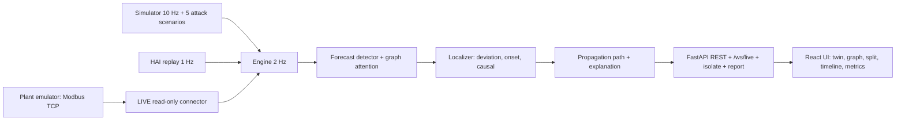

# AttackTrace

Detects an attack on an industrial control process, ranks the origin component, and traces the propagation path. Sustainathon 2026, problem AI-07 Attack-Localization.

## What it does
- Input: a live stream of sensor and actuator values (2 Hz) from a simulated water plant, a replay of the HAI 20.07 dataset, or a real Modbus TCP read from an emulated plant (LIVE mode).
- Detects: forecast-error scores over a learned causal graph, EWMA, 3-sample persistence.
- Localizes: ranks the origin with three signals (deviation 0.6, onset 0.2, causal 0.2).
- Explains: propagation path with onset times, MITRE ATT&CK for ICS tag, recommended action.
- Contains: `Isolate` acts on the answer and the plant recovers (or visibly does not for a wrong node). Each incident exports a one-page PDF.
- Compares: a baseline (Isolation Forest + 3σ) floods 6 alarms where AttackTrace names 1 origin.

## Quick start
```bash
cp .env.example .env            # Windows: copy .env.example .env
docker compose up --build       # first start trains the models: 22 s measured; +~2 min if reports/metrics.json is missing
# UI  http://localhost:5173      API  http://localhost:8000/api/status
```
`.env.example` sets a demo key (`AT_API_KEY`, `VITE_API_KEY`) that protects the write endpoints; change it before exposing the demo.
Local dev: Python 3.11, Node 22, `make setup`, `make dev`. Checks: `make lint`, `make test`. Evaluation: `make eval` rewrites `reports/metrics.json`.

LIVE mode (optional, real protocol): the submission ships a small (~1.5 MB) pretrained LIVE detector under `backend/models/live/`, warm-started from the SIM weights and fine-tuned on 20 minutes of the emulator's own clean traffic, so `docker compose up --build` with the bundled `plant-emulator` service connects immediately — no wait. To retrain it yourself (e.g. after editing the emulator or tag map): `make emulator` starts the plant emulator, `make live-train` records 20 minutes of its clean traffic and retrains (real time, ~20 min), `make eval-live` rewrites `reports/live_metrics.json`. Attacks against LIVE mode are launched only through `attacker/` (CLI: `python -m attacker`), which is allowlisted to loopback and the compose network — the backend's `app/live/` package never writes to the plant.

## Demo script
1. Open http://localhost:5173. Pill reads **Normal**. Wait 30 s after any Reset.
2. Attack console: *Sensor offset*, target *LIT101*, press **Launch**.
3. The LIT101 badge shows the spoofed reading next to `true …`; the tank overfills.
4. Within seconds the pill turns **Incident**. The panel names LIT101, confidence, a score-breakdown bar, path, action, T0856. A close call reads **Ambiguous** with the top 3.
5. Press **Split**: baseline alarm flood on the left, one origin on the right.
6. Press **Graph**: a pulse runs along the attack path.
7. Press **Isolate LIT101**: the plant recovers and the panel reads **Contained** with seconds. The **Report** icon downloads the PDF.
8. Open **Metrics** for F1, Top-1/Top-3, Contained, Ambiguous.
9. Optional: the **HAI** toggle replays real plant data (needs `data/hai/`, see Third-party resources).
10. Optional: the **LIVE** toggle (needs `make emulator` + `make live-train`) ingests the same attack scenarios over a real Modbus TCP read, with a calibrating ring before the detector is warm and a quality marker on any stale or out-of-range tag.

## Architecture


## Results
Held-out simulator attacks: 50 attacks (10 per scenario), 20 clean 5-minute runs, unseen seeds. Source: `reports/metrics.json`.

| | AttackTrace | Baseline |
|---|---|---|
| Detection F1 | 0.904 | 0.766 |
| False alarms per hour | 0.0 | 3.6 |
| Origin Top-1 / Top-3 | 0.84 / 1.00 | 0.68 / 0.86 |
| Time to localize | 23.3 s | n/a |

Isolating the Top-1 candidate contained 40 of 48 detected attacks (a wrong node: 0 of 48); 6 of 50 incidents are flagged Ambiguous. HAI `test1` (28 attacks, held out): strict F1 0.428 (recall 0.276), point-adjusted 0.915, 22 of 28 detected.

LIVE mode, real Modbus TCP read against the emulator, 30 seeded attacks (6 per scenario) plus a clean run: detection F1 0.951 (recall 0.906, 0 false alarms/h), origin Top-1 0.833 / Top-3 0.867, mean time to localize 8.1 s. Modbus read latency: p50 1.6 ms, p95 2.4 ms. Source: `reports/live_metrics.json` (`python -m eval.live`); not validated on physical hardware.

## Third-party resources
Libraries, dataset, fonts and MITRE data are listed with versions and licences in `submission/THIRD_PARTY.md`.
- HAI 20.07 (ETRI): not included in this repo. Download `train1`, `test1`, `test2` from https://github.com/icsdataset/hai into `data/hai/`.
- The HAI licence is stated twice and inconsistently by the source (CC BY-SA 4.0 and CC BY 4.0). See `THIRD_PARTY.md`.
- The UI loads Inter and JetBrains Mono from Google Fonts; offline it falls back to system fonts.
- LIVE mode adds two dependencies: pymodbus (BSD-3-Clause) for the Modbus TCP client and server, PyYAML (MIT) for the tag map. Both are stdlib-adjacent, no network calls beyond the plant.

## Limitations
- The simulator is our own model. Its results do not show performance on a real plant.
- HAI: strict F1 is 0.428 because recall is 0.276. Labels name the process, not the component. Thresholds need one labelled tuning day.
- One attack at a time is evaluated. Slowest case: `sensor_ramp`, Top-1 0.50.
- The Top-1 isolate click was wrong for 8 of 48 incidents. The Ambiguous gate flags only 2 of the 8 wrong answers.
- Containment is decided with simulator truth about whether an attack still acts.
- The demo key is in the browser build: a deterrent, not authentication.
- The learned graph (185 HAI edges) is not validated against plant documentation.
- LIVE mode ingests real Modbus TCP traffic, but from an emulated plant; it is not validated on physical hardware. Its detector is warm-started from the simulator weights and fine-tuned on only 20 minutes of live clean traffic.

## Licence
MIT. See `LICENSE`. This covers the project code only; third-party licences are in `submission/THIRD_PARTY.md`, and the HAI dataset is not included.
