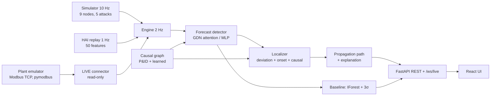

# AttackTrace: Documentation

Sustainathon 2026, problem AI-07 Attack-Localization.
All numbers come from `reports/metrics.json` (regenerated by `python -m eval.run`, byte-identical on re-run) or from a command named next to the number.

## 1. Problem

An attack on an industrial control system raises many alarms at once. Operators need the origin component, not the alarm list.

| Fact | Value | Source |
|---|---|---|
| Alarms a 3σ baseline raised for one `sensor_offset` attack on LIT101 | 6 (max over the incident) | live run via `/ws/live`, `baseline_alarms` |
| Baseline false alarms on clean runs | 3.6 per hour | `metrics.json` detection.baseline |
| Baseline Top-1 origin accuracy | 0.68 | `metrics.json` localization.baseline |

Task: detect the attack, name the origin component, and show how the effect travelled.

## 2. Solution overview

AttackTrace has four stages. Each stage is a module in `backend/app/`.

| Stage | Module | Output |
|---|---|---|
| Detect | `detect/` | alert when forecast error is high for 3 samples |
| Localize | `localize/` | ranked origin candidates with confidence |
| Trace | `propagate/` | path of nodes ordered by onset time |
| Explain | `explain/` | text, recommended action, MITRE ATT&CK for ICS ID |

The UI (React) shows a digital twin, a causal graph, a baseline-vs-AttackTrace split view, a replayable timeline and a metrics page. The backend streams one state message at 2 Hz over WebSocket. The REST/WebSocket contract is frozen between `backend/app/schemas.py` and `frontend/src/lib/types.ts`.

## 3. Method

### 3.1 Causal graph
- Static edges: 14, from the plant's P&ID.
- Learned edges: 45 on the simulator, from Granger tests on first differences. Learned weight is capped at 0.5.
- HAI: 185 edges from one multivariate lagged regression (pairwise Granger took 231 s and gave 883 edges).

### 3.2 Detection
- A model predicts the next sample of every node from the last 10 samples (5 s at 2 Hz). The simulator uses the graph-attention model (`gdn`) with the learned edges as the attention mask. An MLP is the fallback.
- Score per node: forecast error divided by that node's clean-data spread. EWMA 0.25 smooths it.
- Alert: mean of the top-2 node scores above a threshold (4.11, tuned on validation seeds) for 3 consecutive samples.
- Stuck-sensor check: a sensor exactly constant for 3 s gets a fixed large error. Without it a frozen sensor looks like a good prediction.

### 3.3 Localization: three signals
Each node gets a score. The ranking is a softmax of the scores (temperature 0.062, calibrated by log-loss on tuning attacks).

`score = 0.6 · deviation + 0.2 · onset + 0.2 · causal`

| Signal | Meaning | Why it is needed |
|---|---|---|
| Deviation (0.6) | How far the node's error peaked above its clean threshold | The origin deviates most. Alone it confuses a sensor with the controller that reads it. |
| Onset (0.2) | How early the node first crossed its threshold | A cause moves before its effects. Alone it is noisy at 0.5 s resolution. |
| Causal (0.2) | Personalized PageRank on the reversed graph | Nodes that explain many other deviating nodes rank higher. Alone it ignores magnitude. |

Weights were tuned on seeds 400–419, each weight at least 0.2. Top-1 moved between 0.57 and 0.76 across weight choices on the tuning set, so the exact weights are not critical.

Score breakdown: every ranked candidate carries its own `weight x signal` contributions (`incident.origin[].breakdown`) and the weights used. They sum to that node's own score. Inside a tie group the ranked score is another member's score, so the breakdown shows each node's own terms. The UI draws them as a 3-segment bar per candidate.

Tie rule: a spoofed sensor and its own PLC deviate in the same 0.5 s sample. Candidates scoring at least 60% of the best, with onset within 1 sample, form a tie group. Order inside the group: earliest onset, then most group members downstream over the P&ID, then sensor before controller before actuator.

Effect: Top-1 moved from 0.66 to 0.88 on the earlier 50-attack set.

### 3.4 Propagation and explanation
- Path: nodes with a detected onset, ordered by onset time. Same-sample onsets are ordered by weighted P&ID distance from the origin.
- Time values stay at the sample resolution (0.5 s). No sub-sample times are invented.
- Explanation: deterministic templates, no language model. MITRE IDs: T0856 (sensor attacks), T0831 (actuator force), T0855 (rogue setpoint).
- Incident window: 40 s before the alert to 10 s after. The 10 s is the time-to-localize cost.

### 3.5 Incident lifecycle
`localizing` (10 s of refinement) → `open` → `closed`. An incident closes after 30 s without an alert and with no tank overflow or dry-run estimate. The hazard condition was added after a screenshot showed an incident closing while a tank was still overfilling. When the operator isolates the attacked node and the plant recovers, the status becomes `contained` instead (3.7); the incident stays on screen for 10 s.

### 3.6 Confidence gate
- An incident is `ambiguous` when top-1 minus top-2 confidence is below 0.21 (`AT_GATE_MARGIN`). The ranking is not changed; the UI then shows the top 3 at equal weight with an `Ambiguous` label.
- Rule fixed before looking at data: the smallest margin whose non-ambiguous incidents reach Top-1 0.95. It was tuned on 140 validation and tuning attacks (seeds 300-307 and 400-419 per scenario), never on the test attacks.
- The margin is a simulator calibration. HAI incidents are never flagged.

### 3.7 Isolate and recover
- `POST /api/isolate {incident_id, node_id}` (simulator only; HAI returns 409). An isolated sensor reports its honest reading, an isolated actuator follows its controller, an isolated controller reverts to its authorized setpoint. The plant is not reset.
- Isolating a node that is not under attack changes nothing, so the attack keeps acting. Side effects of putting a healthy controller in manual mode are not modelled.
- `contained` needs two things: the isolate action removed every attack that was live, and every node score then stayed under the alert threshold for 5 s (`AT_CONTAIN_S`). The simulator knows whether an attack still acts; the detector alone cannot see a settled offset.
- `contained_at` and `time_to_contain_s` (plant seconds from the action) are recorded on the incident. An incident whose attack ends by itself closes as `closed`, not `contained`.

### 3.8 Securing the demo app
- `POST /api/attack`, `/isolate`, `/reset` and `/mode` need header `X-API-Key` equal to `AT_API_KEY` (401 otherwise). Read-only endpoints and `/ws/live` stay open.
- `/api/attack` is limited to 10 per minute per client (`AT_ATTACK_RATE_PER_MIN`, in-process sliding window, 429 with `Retry-After`).
- `AT_DEMO_MODE=false` makes `/api/attack` return 403.
- The browser build carries the key (`VITE_API_KEY`). This deters misuse of an exposed demo. It is not user authentication, and the rate limit resets on restart.
- With `AT_API_KEY` empty the write endpoints stay open (local development); the server logs a warning. `.env.example` ships a placeholder key to change.

### 3.9 Incident report
`GET /api/incidents/{id}/report.pdf` returns a one-page PDF: origin, confidence, candidates with breakdown, path, timeline, action, MITRE ID, worst impact values seen, baseline alarms and containment. It is written by a small stdlib PDF writer (no new dependency). Sample: `submission/evidence/sample_incident_report.pdf`.

### 3.10 LIVE ingestion: a real industrial protocol

A third mode ingests the same plant model over Modbus TCP, the wire protocol the simulator stands in for. No hardware is used: `plant_emulator/` runs the identical `Plant` physics (`backend/app/sim/`) behind a Modbus TCP server (pymodbus), publishing 9 process values as input registers and exposing 13 attack-surface registers (spoof offset, sensor freeze, actuator force, rogue setpoint) as holding registers, from `config/tagmap.yaml`.

- **Read-only backend.** `backend/app/live/` (connector, aligner, quality tracker, engine, store) only ever calls Modbus read functions. `tests/test_emulator.py::test_the_live_package_has_no_write_path` scans the package's AST for write calls and fails the build if one appears. `tests/test_emulator.py::test_clients_cannot_write_process_values` checks the protocol fact this relies on: Modbus write function code 16 only ever reaches the holding-register table, never the input registers the engine reads from, whatever address is given.
- **The only writer.** `attacker/` is a separate top-level package (CLI: `python -m attacker`) that is the sole code path allowed to write to the emulator's holding registers. It is allowlisted to loopback, the Docker Compose host name, and an explicit `ATTACKER_ALLOWLIST`; connecting to any other host raises before a socket opens. The backend's own attack button in LIVE mode calls this module through `backend/app/api/live_attack.py`, which is deliberately kept outside `app/live/` so the read-only AST test stays meaningful.
- **Quality-aware masking.** Every tag carries a quality (`good`, `stale`, `missing`, `out_of_range`) from `backend/app/live/quality.py`. A stale or missing tag is masked out of the detector's input (last-good value held, not fed as a fresh observation) and excluded from the origin ranking, so a network hiccup cannot be reported as an attack origin. `out_of_range` behaves the same; `frozen` quality is advisory only (a genuinely frozen sensor is exactly what `sensor_freeze` attacks look like, so it must stay rankable).
- **Calibrating lifecycle.** A LIVE engine starts `waiting` (no connection), then `calibrating` while it accumulates clean samples, then `running` once the detector has enough history; the UI shows a progress ring during calibration instead of a cold, misleading score.
- **Model.** The LIVE detector is warm-started from the simulator's trained weights and fine-tuned on 20 minutes of the emulator's own clean traffic (`make live-train`), rather than trained from nothing on a small live-only sample.
- **Persistence.** LIVE incidents are the only ones stored to disk (SQLite, `backend/app/live/store.py`); SIM and HAI stay replayable from the live ring buffer as before.
- **Metrics merge.** `reports/live_metrics.json` is a separate file; `GET /api/metrics` merges it under a `live` key at response time only. `reports/metrics.json` itself is never touched by LIVE code — verified byte-identical before and after adding LIVE mode.
- **Honest label.** LIVE mode ingests a real industrial protocol, but from an emulated plant; it has not been run against physical hardware. This sentence is repeated in the README, the UI (source pill) and here on purpose.

## 4. Data

| Source | What | Used for |
|---|---|---|
| Simulator (own code, `backend/app/sim/`) | Water plant, 9 nodes, 10 Hz, seeded. 5 attack scenarios. | Training, tuning, held-out evaluation, live demo |
| **HAI 20.07 (real data): used, optional** | `train1`, `test1`, `test2`; 1 Hz; 50 usable features | HAI mode and the HAI rows of the evaluation |
| **LIVE: own emulator, real protocol** | Same simulator physics served over Modbus TCP by `plant_emulator/`; polled at the same 2 Hz | LIVE mode training (20 min clean) and the LIVE rows of the evaluation |

Seeds: train 100–129; validation 200–205 clean and 300–307 attacks; graph 500; weight tuning 400–419 per scenario; test attacks 1000–1009 per scenario; test clean 2000–2019. LIVE evaluation seeds: 3000–3005 (6 per scenario), disjoint from every SIM and HAI seed range.

HAI split: first 90% of `train1` for training, last 10% for validation, `test2` for threshold and weight tuning, `test1` held out. The HAI files are not part of the submission zip.

## 5. Results

### 5.1 Simulator (50 held-out attacks, 20 clean 5-minute runs)

| | AttackTrace | Baseline |
|---|---|---|
| Detection F1 | 0.904 | 0.766 |
| Precision | 0.966 | 0.895 |
| Recall | 0.850 | 0.670 |
| False alarms per hour | 0.0 | 3.6 |
| Mean detection delay | 11.1 s | 12.0 s |
| Origin Top-1 | 0.84 | 0.68 |
| Origin Top-3 | 1.00 | 0.86 |
| Time to localize | 23.3 s | n/a |

| Scenario | Detection F1 | Runs detected | Top-1 | Top-3 | Baseline Top-1 |
|---|---|---|---|---|---|
| sensor_freeze | 0.967 | 1.0 | 0.9 | 1.0 | 0.3 |
| sensor_offset | 0.875 | 1.0 | 0.9 | 1.0 | 0.9 |
| sensor_ramp | 0.673 | 0.9 | 0.5 | 1.0 | 0.5 |
| actuator_force | 0.968 | 1.0 | 1.0 | 1.0 | 0.8 |
| rogue_setpoint | 0.986 | 1.0 | 0.9 | 1.0 | 0.9 |

Weakest case: `sensor_ramp`, F1 0.673 and Top-1 0.5. The baseline equals AttackTrace on Top-1 for three of five scenarios. It is behind by 0.6 on `sensor_freeze` and by 0.2 on `actuator_force`.

### 5.2 Demo rehearsal (15 live runs, `submission/evidence/rehearsal.md`)
- Five scenarios, three runs each, on different targets (`rogue_setpoint` used PLC1 twice and PLC2 once). All 15 detected.
- True origin ranked 1st in 13 runs and 2nd in 2 runs. It was in the top 3 in all 15.
- Time to localize: 11.5 s in 9 runs, 16.5–19.5 s in 4 runs, and 71.5 s and 55.0 s for `sensor_ramp` on LIT101 and LIT301.

### 5.3 HAI 20.07 (`test1`, 28 attacks, never used for tuning)

| | AttackTrace | Baseline |
|---|---|---|
| Detection F1, strict per-sample | 0.428 | 0.077 |
| Precision / recall | 0.948 / 0.276 | 0.040 / 1.000 |
| F1, point-adjusted | 0.915 | 0.077 |
| Attacks detected | 22 of 28 | 28 of 28 (always in alarm) |
| Mean detection delay | 143 s | 0 s (always in alarm) |
| False alarms per hour | 0.18 | 0.01 |
| Process Top-1, all attacks | 0.714 | 0.0 |
| Process Top-1, detected attacks | 0.909 | n/a |
| Always answering "P1", detected attacks | 0.864 | n/a |

Read these with care. Strict F1 is 0.428 because recall is 0.276; point-adjusted F1 rewards one hit inside a long attack and is the optimistic number.

On detected attacks the process answer beats always answering "P1" by 0.909 − 0.864 = 0.045, on 22 attacks.

### 5.4 Confidence gate and isolation (`ambiguity` and `isolation` in `metrics.json`)

Gate, 50 held-out attacks (margin 0.21):

| | Value |
|---|---|
| Ambiguous incidents | 6 of 50 (0.12) |
| Top-1 on non-ambiguous incidents | 0.864 (44 incidents) |
| Top-1 on ambiguous incidents | 0.667 (6 incidents) |
| Top-3 on ambiguous incidents | 1.00 |

The gate is weakly informative: of the 8 wrong Top-1 answers it flags 2. On the 140 tuning incidents Top-1 was 0.952 on non-ambiguous incidents (0.943 overall), where the weights were also tuned, so that figure is optimistic.

Isolation, 50 held-out attacks, 48 detected, 60 s allowed after the action:

| Node isolated | Contained | Mean time to contain |
|---|---|---|
| Top-1 candidate (what an operator clicks) | 40 of 48 (0.833) | 12.5 s |
| True origin (oracle) | 48 of 48 (1.00) | 13.9 s |
| A wrong node (control) | 0 of 48 | n/a |

Top-1 isolation by scenario: freeze 9 of 10, offset 9 of 10, ramp 3 of 8 detected, actuator 10 of 10, setpoint 9 of 10. Counted over all 50 attacks (2 undetected) the Top-1 click contains 0.80. The oracle row is partly by construction (see 3.7); the Top-1 row is the honest figure.

### 5.5 LIVE mode: real protocol, emulated plant (`reports/live_metrics.json`, `reports/live_faults.json`)

30 seeded attacks (6 per scenario, seeds 3000–3005) plus one clean run, through the real Modbus TCP read path against `plant_emulator/`. Not validated on physical hardware.

| | LIVE | Simulator (5.1) |
|---|---|---|
| Detection F1 | 0.951 | 0.904 |
| Precision / recall | 1.000 / 0.906 | 0.966 / 0.850 |
| False alarms per hour | 0.0 | 0.0 |
| Origin Top-1 | 0.833 | 0.84 |
| Origin Top-3 | 0.867 | 1.00 |
| Mean time to localize | 8.1 s | 23.3 s |
| Modbus read latency (p50 / p95 / p99) | 1.6 / 2.4 / 3.0 ms | n/a |

LIVE's lower Top-3 than the simulator's (0.867 vs 1.00) comes from `sensor_ramp`: 2 of 6 live runs ranked the origin outside the top 3 (both the live detector's threshold and the 20-minute warm-start sample are smaller than the simulator's). Latency is the Modbus read round-trip only; it excludes the up-to-poll-interval wait for a changed register and browser rendering, since this evaluation has no browser client.

Fault injection (`python -m eval.live_faults`, 3 checks, each against a real emulator instance): emulator killed mid-run → source reports `down`, no exception, no false origin (pass); every read delayed past `stale_after_s` (simulated slow network) → quality turns `stale`, no exception (pass); an extreme `sensor_offset` (1.0e6) drives LIT101's input register out of range → quality turns `out_of_range`, the corrupted node is excluded from the origin ranking (pass). 3 of 3 passed.

Soak (`python -m eval.live_soak`, 60 minutes, real time, `reports/live_soak.json`): one attack launched every 10 minutes (5 total) and the emulator force-killed twice, at the 20- and 40-minute marks. 0 exceptions over 3,600 s. Both forced kills were noticed and reconnected in 3.5 s. Resident memory went from 350 MB to 87 MB over the run (no leak; Windows trimmed the idle working set, it did not grow), mean CPU 113% of one core on a laptop.

## 6. Novelty, feasibility, scalability, sustainability

### Novelty
- Localization is the output, not a by-product. The detector's alert opens an incident that carries origin, confidence, path and action.
- The three signals address different failure modes; the tie rule resolves sensor-versus-PLC ties that deviation alone cannot (Top-1 0.66 → 0.88 on the earlier set).
- Confidence is calibrated: held-out mean top-1 confidence 0.87 vs accuracy 0.88 at the earlier calibration. It was recalibrated afterwards (temperature 0.062) and was not re-measured as a separate figure.
- Same pipeline runs on the simulator, on real HAI data, and over a real Modbus TCP read, through one UI and one API contract.
- Detect, locate, contain: the operator can act on the answer (Isolate) and the plant visibly recovers, or does not when the wrong node is chosen. Containment is never assumed.
- Honest uncertainty: close calls are labelled `Ambiguous` and show the top 3.

### Feasibility
- Runs on CPU. `docker compose up --build` starts the full stack. First start trains the models: backend healthy after 22 s in the clean-start test (`submission/evidence/docker_clean_start.txt`). If `reports/metrics.json` is missing the first start also evaluates, which adds about 2 minutes (two measurements: 55 s and 51 s). Later starts take seconds.
- Training is seeded and deterministic. A clean copy reproduces `metrics.json` exactly on the same platform.
- Docker clean-start with the emulator (Phase 13): `backend/models/` emptied, `docker compose up --build` with `plant-emulator` in the stack. Both `backend` and `plant-emulator` reported `healthy`; the backend retrained SIM, HAI and the baseline from scratch (about 3.5 minutes, mostly image build); `POST /api/mode {"mode":"live"}` connected to the real emulator and entered `calibrating` (no LIVE model was trained in this run, by design — that path records clean traffic for `make live-train` instead of failing). No errors in either container's logs. `reports/metrics.json` was untouched (same checksum before and after).
- Test evidence: pytest 237 passed, vitest 127 passed, Playwright 6 passed (key enforced), mypy strict clean on `app`, `eval`, `plant_emulator` and `attacker`.

### Scalability
- Measured: 9 nodes (simulator) and 50 features (HAI) on the same code.
- HAI graph learning took 1.7 s for 50 features with the multivariate method. The pairwise method took 231 s, which is why it was replaced.
- Measured speed: median 1.1 ms and p95 2.3 ms per 0.5 s step on a laptop CPU (`submission/evidence/step_latency.txt`). Model files: 6.6 KB (graph attention), 120 KB (MLP).
- Not measured: hundreds of nodes, multi-site deployments, edge hardware. No claim is made.

### Sustainability
- Detecting a physical hazard early lowers waste. In the simulator the impact panel reports energy wasted (kWh) and overflow or dry-run ETAs. These are simulator estimates, not field measurements.
- CPU-only inference at 2 Hz. No GPU is required.

## 7. Limitations

- **Simulator vs real data.** The simulator is our own model. Results on it do not predict results on a real plant. HAI is the only real data, and results there are weaker.
- **HAI recall is low.** Recall 0.276, 6 of 28 attacks missed, mean delay 143 s. Most HAI attacks are slow.
- **HAI labels are per process.** Localization there is scored per process (P1–P3), not per component. Component-level accuracy on real data is unknown.
- **HAI thresholds do not transfer between days.** Clean-train thresholds fail on test days. One labelled tuning day was needed (`test2`).
- **Multiple simultaneous attacks.** Evaluation injects one attack at a time. Behaviour with several concurrent origins is not measured.
- **Slow drift.** `sensor_ramp` on a self-consistent loop: Top-1 0.5 and one of 10 runs undetected.
- **The Top-1 click can be wrong.** 8 of 48 detected incidents were not contained when the Top-1 node was isolated (3 of 8 `sensor_ramp` contained). The UI then offers the next candidate after 30 s.
- **Containment uses simulator truth.** The simulator decides whether an attack still acts. A real plant would need an independent check. A wrong isolation changes nothing in the model; real side effects of manual mode are not simulated.
- **The confidence gate is weak.** It flags 2 of the 8 wrong Top-1 answers and is calibrated on the simulator only.
- **Demo security is a deterrent.** The key is in the browser build, the rate limit is per process, and an empty key leaves writes open.
- **HAI improvement attempts failed.** Two time-boxed experiments (longer minimum alert duration, slower smoothing) raised tuning-day F1 by at most 0.009 against a bar of 0.02. HAI strict F1 stays 0.428 (`submission/evidence/hai_experiments.txt`).
- **Learned graph quality.** The 45 learned simulator edges and 185 HAI edges are statistical and are not validated against plant documentation.
- **Sample size.** 50 simulator attacks (10 per scenario) and 28 HAI windows. Differences of a few points are within noise.
- **Platform differences.** Linux Docker gave 23.7 s time-to-localize; Windows gave 23.3 s.
- **UI text size.** Text is at least 12 px everywhere except the mini-twin in Split view (9.8 px at 1440 wide, 8.3 px at 1280). The React Flow attribution stays (its documentation allows removal only with a Pro subscription).
- **LIVE mode is a real protocol, not a real plant.** It is not validated on physical hardware; `plant_emulator/` runs the same simulator physics behind a Modbus TCP server. Its detector is warm-started from the simulator weights and fine-tuned on only 20 minutes of live clean traffic, far less than the simulator's own training sample.
- **LIVE Top-3 is lower than the simulator's on one scenario.** `sensor_ramp`: 2 of 6 live held-out runs ranked the true origin outside the top 3 (5.5).
- **LIVE mode cannot isolate.** `POST /api/isolate` returns 409 in LIVE mode (`live-read-only`): the backend never writes to the plant, by design (3.10), so containment (3.7) is not available there. The incident's own `action` text is returned as advice instead. The `ambiguous` gate (3.6) does still run on LIVE incidents, using the simulator-calibrated margin; it was not separately re-measured on LIVE data.
- **Adversarial robustness is untested.** The forecaster's thresholds and the three-signal ranker's weights and tie-break rule (3.4) are documented and deterministic. No attempt has been made to craft a slow drift that stays under the per-node alert threshold, or to sequence a multi-stage attack specifically to mislead the onset/causal-position tie-break toward the wrong origin. This is the largest untested assumption behind the attribution claim.

## 8. Ethics and responsible use

- Attack code exists only inside the bundled simulator (`backend/app/attacks/`) and, for LIVE mode, inside the separate `attacker/` package. Both are allowlisted to loopback and the project's own compose network (3.10); neither can send traffic to an arbitrary network target.
- Attack and isolate endpoints are protected by a key, a rate limit and a demo-mode switch (3.8). Isolate always returns 409 in LIVE mode: the backend cannot write to the plant (3.10).
- The attack console only acts on the simulated plant or the project's own emulated plant. In HAI mode it is disabled and the API returns 409.
- The LIVE backend (`app/live/`) is enforced read-only toward the plant by a unit test that scans its source for write calls, not only by a design intention.
- No secrets, `.env` values or raw HAI data are included in the submission.
- The tool recommends actions. It does not actuate anything.
- False alarms matter in a plant: the simulator held-out false-alarm rate is 0.0 per hour on 20 clean runs; the HAI rate is 0.18 per hour.

## 9. Third-party resources

Full table with versions, licences and links: `submission/THIRD_PARTY.md`.

| Resource | Licence | Role |
|---|---|---|
| HAI 20.07 (ETRI) | Ambiguous in source: CC BY-SA 4.0 and CC BY 4.0. Treated as CC BY-SA 4.0. Not redistributed. | Real-data evaluation and replay |
| PyTorch 2.14.1 | BSD-3-Clause and others | Forecaster |
| scikit-learn 1.9.1, statsmodels 0.15.0, NetworkX 3.6.1, NumPy 2.4.6, pandas 3.0.6, SciPy 1.17.1 | BSD | Baseline, Granger tests, graph, data |
| FastAPI 0.142.2, Uvicorn 0.54.0, Pydantic 2.13.5 | MIT / BSD-3-Clause | API |
| React 18.3.1, React Flow 12.12.0, ECharts 6.1.0, Zustand 5.0.15, Framer Motion 14.0.0 | MIT / Apache-2.0 | UI |
| Inter, JetBrains Mono (`@fontsource-variable`) | OFL (not re-verified) | UI fonts, self-hosted in the build; no runtime network call (Phase 15) |
| MITRE ATT&CK for ICS | MITRE terms of use (not re-verified) | Technique IDs T0856, T0831, T0855 |
| pymodbus 3.15.0 | BSD-3-Clause | Modbus TCP client (`app/live/`) and server (`plant_emulator/`) |
| PyYAML 6.0.3 | MIT | Loads `config/tagmap.yaml` |

No paid API or API key is used.
